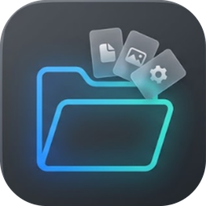
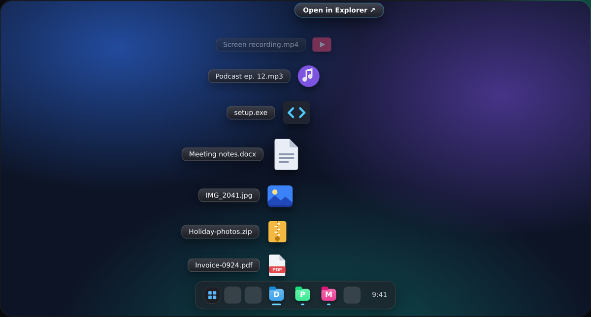

<p align="center"></p>

<h1 align="center">Foldy</h1>
<p align="center"><b>macOS-style fan stacks for your Windows taskbar.</b><br>
Pin any folder. Click it. Its contents spring out above the button along a smooth arc.</p>

<p align="center">
  <a href="https://github.com/vinchezko/Foldy/releases/latest/download/Foldy.exe"><b>⬇ Download Foldy.exe</b></a> ·
  <a href="https://vinchezko.github.io/Foldy/">Website &amp; live demo</a> ·
  <a href="https://github.com/vinchezko/Foldy/releases">Releases</a>
</p>

<p align="center"></p>

## Features

- **Pin as many folders as you like.** Each becomes its own real taskbar button with its own coloured icon.
- **Opens exactly above the right button.** For a mouse click, Foldy records the click itself and asks Windows (UI Automation) for that button's real
  rectangle, so it doesn't matter where the pointer goes afterwards. For **Win+1, Win+2…** (no click at all) it notes which number you pressed and finds that button by its identity, then by its position on the bar, so
  the mouse can be anywhere. It reads the taskbar's real size too, so any display scale, taskbar size or auto-hide setup works and the fan never overlaps the taskbar.
- **Spring-physics animation**, staggered per item, timed per frame so it stays smooth at any refresh rate.
- **Fisheye hover** that pushes neighbours apart, so icons never collide.
- **Kinetic scrolling** for big folders: momentum, rubber-band at the ends, edge fades.
- **Drag files out of the fan.** Press on any file or folder in the fan and drag: drop it into a browser upload, a chat window, an editor or an Explorer window. A plain click still opens it. Dragging *copies* by default, so uploading something never removes the original (hold **Shift** to move).
- **Drop files onto a stack.** Drag files from Explorer (or any app) and hold them over a pinned button: its fan opens. Drop on the fan to put them in that folder, or on a folder inside the fan to put them in that sub-folder. (Dropping straight onto the taskbar button also works wherever Windows allows it.) Foldy moves or copies them with Explorer's own progress dialog and name-clash handling. **Ctrl** copies, **Shift** moves; otherwise *Settings → Files dropped on a button* decides (**Smart** = move on the same drive, copy across drives, like Explorer).
- **Spring-loaded folders and a drop placeholder.** While a file is being dragged over a fan, a blue **“↓ Drop in <folder>”** pill appears at the top: drop on it (or on empty fan space) to put the file in that folder. Rest the file on a folder for a moment and the fan opens it (the pill follows); rest it on the **◀ back** pill and it goes back up. You can also drag a file from the fan onto a folder in the same fan, or onto the back pill to move it up a level. Move the drag away from the fan and the fan closes. While you carry a file out of a fan, a round **✕** appears in the top-left corner of the screen: it grows into a “Cancel move” pill when you reach it, and dropping the file there cancels the move.
- **Folders inside folders** (optional, on by default): click a folder in the fan and it unfolds in place, with a ◀ back pill. Toggle it in Settings.
- **Type to filter.** Open a big folder and just start typing: a search pill appears on top of *Open in Explorer* and the fan narrows to matching names (best matches nearest the taskbar). `Enter` opens the top match, `Backspace` deletes a letter, `Esc` clears the search (a second `Esc` closes the fan). Switch it off in Settings.
- **A settings window that is easy to find your way around.** A sidebar with five pages (Appearance, Behaviour, Features, Stacks, Updates & about). Every slider says what it does, every choice explains itself, the Stacks page lists your pinned folders (click one to open it), a trash button on each one removes it (button, shortcut and icon; never your folder), and *Preview fan* is always at the bottom.
- **Keyboard control.** With a fan open, `↑` / `↓` move through the items (the first press lands on the one next to the taskbar), `Enter` opens the selected one, `Shift+Enter` shows it in Explorer, `→` dives into a folder, `←` or `Backspace` goes back, `Home` / `End` / `PgUp` / `PgDn` jump. The mouse takes over again the moment you move it.
- **Customize any stack's icon.** On *Settings → Stacks* a palette button sits next to the bin on every stack. It opens an editor with a live preview of the real taskbar icon: pick a **texture** (Solid, Gradient, Zebra, Forest, Ocean, Sunset, Leopard, Carbon, Galaxy, Camo, Honeycomb, Candy; all drawn in code), a **colour** (16 swatches, the automatic hue, or any colour you like for Solid and Gradient), and the **text or emoji** written on it (up to two characters, a quick emoji row, or paste your own), with Auto / White / Dark lettering. *Apply* rewrites the stack's icon and, if you leave the box ticked, restarts Explorer for a moment so the taskbar shows it; *Reset to default* brings back the automatic look.
- **Smart stacks.** A stack can be a rule instead of one folder: *Recent files*, *Newest 20 downloads*, *Recent pictures*, or your own mix of places, file type (pictures, videos, documents, audio), age (today / 7 / 30 days) and count. Tray icon or Settings → **Smart stack…**. It pins to the taskbar like any other stack and re-scans itself in the background so it opens instantly.
- **Right-click menu** on any item, drawn to match the fan: a header with the item's picture, name, size and date, then Open, Open with…, Show in Explorer and Copy path, with line icons and key hints. Works with the keyboard too (menu key or `Shift+F10`, then `↑` `↓` `Enter`).
- **Real thumbnails** for pictures, videos and PDFs instead of generic icons. They load in the background (three at a time), fade in, and are remembered on disk, so a file you have seen once shows its picture the moment the fan opens. They also follow the file when you drag it out. Videos and PDFs use the same thumbnails Explorer shows (PDFs need a PDF thumbnail handler, e.g. Edge or Acrobat); files without one keep their normal icon.
- **Fast, even in huge folders.** Pinned buttons run a ~100 ms launcher; icons and labels are pre-loaded. Exact file icons (every `.exe`, `.lnk`, `.msi` has its own) and big folder listings load on background threads, and a fast scroll builds only a few items per frame, so the fan keeps gliding through folders with thousands of files.
- **Compact settings window** (density, speed, glass opacity, magnification, arc curve, item count, sorting…) with animated switches, a sliding sort control and a reset button on every slider.
- **Updates itself, politely.** Foldy checks this repository's latest GitHub release (at start-up and every 6 hours; switch it off in Settings). When there is a newer version it asks **Update now / Later**. *Later* leaves a green **Update** button next to *Reset all* (and an entry in the tray menu). The download comes only from this repo's releases and is checked against its size and SHA-256 before it is installed.
- **Pins harder.** If Windows refuses every automatic pin route, a small card appears whose icon you drag onto the taskbar.
- **Clean install and uninstall**, each with a live progress window. Uninstall is a hold-to-confirm ring button.
- **Private.** No telemetry. The only network request is the update check to `api.github.com` (and only if you leave it on).

## Install

1. Download **`Foldy.exe`** from the [latest release](https://github.com/vinchezko/Foldy/releases/latest) and run it.
2. An install window shows each step, then a folder picker opens. Pick a folder and Foldy pins it to the taskbar.
3. Click the new button. Add more folders any time from the tray icon.

Windows may show *"Windows protected your PC"* for a new, unsigned app: click **More info → Run anyway**.

> **Auto-pin note:** Windows has no public API for pinning to the taskbar, so Foldy uses an undocumented route and checks that it worked. If your Windows build blocks it, Foldy opens the shortcut in Explorer: right-click it → *Show more options* → *Pin to taskbar*.

Supported: Windows 10 / 11 (64-bit), taskbar at the bottom of the primary monitor (normal or auto-hide).

## Using it

| Action | Result |
|---|---|
| Click an item | Opens it with its default app |
| Drag an item out of the fan | Drops the real file where you let go (upload box, chat, editor, Explorer). The fan folds away afterwards |
| Hold dragged files over a pinned button, then drop on the fan | Moves or copies them into that folder (**Ctrl** = copy, **Shift** = move; hold the key for a moment after you drop) |
| Click **Open in Explorer ↗** (top of the arc) | Opens the folder |
| Scroll wheel / touchpad | Scrolls long folders |
| `↑` `↓` / `Enter` / `Shift+Enter` / `→` `←` | Select / open / show in Explorer / into a folder / back |
| Right-click an item | Open, Open with…, Show in Explorer, Copy path |
| Start typing in an open fan | Filters it by name; `Enter` opens the top match, `Esc` clears |
| Click outside, `Esc`, or the button again | Closes the fan |
| Click a folder in the fan | Opens it inside the fan; **◀** (or `Backspace`) goes back up |
| Click the tray icon (or right-click → **Settings…**) | Opens the settings window |
| Settings → **Uninstall** | Hold the ring button to remove Foldy completely |

## Build from source

Requires Windows and Python 3.11+.

```bat
git clone https://github.com/vinchezko/Foldy.git
cd Foldy
packaging\build.bat
```

That installs the dependencies, builds the tiny launcher, then builds the single-file **`dist\Foldy.exe`**
(`--onefile --noconsole`, icon and version info embedded, launcher included).

Run from source without building: `pip install PyQt6 pywin32`, then `python src\run_foldy.py`.

### Publishing a release

Build, then attach `dist\Foldy.exe` to a GitHub release. Keep the file name `Foldy.exe` so the website's download button and the in-app updater work.

For updates to be offered, tag the release with a version **higher than the one users run** (`v1.3.7` → `v1.4.0`, `v1.4.1`…) and publish it as a normal release (not a draft or pre-release). Bump `VERSION` in `src/foldy/constants.py` and the two numbers in `packaging/version_info.txt` before building. People on v1.0.0 have no updater yet, so they install v1.1.0 or newer once by hand.

The website's download counter adds up the `.exe` downloads of all releases (it includes updates downloaded by the app).

## Website

The site in [`docs/`](docs) is plain HTML/CSS/JS with no build step: parallax scrolling, a live port of the fan physics you can play with, a settings replica, install/uninstall demos and a download section.

1. Push the repo to GitHub.
2. **Settings → Pages → Build and deployment → Deploy from a branch → `main` / `/docs`.**
3. If your repository isn't `vinchezko/Foldy`, change `REPO` at the top of `docs/js/main.js` (and the `og:image`/links in `docs/index.html` if you like).

## Project layout

```
src/
  run_foldy.py          entry script (what PyInstaller bundles)
  foldy/                the app
    app.py              Foldy.exe entry: install hand-off, IPC
    hub.py              resident app: tray, IPC server, fan control, add/pin and uninstall flows
    fan.py              fan overlay: arc layout, springs, magnification, scrolling
    ctxmenu.py          the right-click menu of an item
    smartdialog.py      the "New smart stack" window
    keyhook.py          keyboard hook that feeds typing to the open fan
    thumbs.py           background thumbnails (images, videos, PDFs)
    render.py           cached icons, glass labels, folder listings
    winutil.py          Windows helpers: taskbar geometry, UI Automation, click tracker
    dropzone.py         files dropped on a pinned button: move/copy decision and transfer
    shortcuts.py        shortcut icons, .lnk creation, taskbar pinning, folder picker
    iconstyle.py        colours, textures and lettering of a stack's icon (drawn in code), saved per stack
    icon_editor.py      the "Customize icon" window
    updater.py          GitHub release check, verified download
    update_window.py    'Update now / Later' window and the drag-to-pin helper
    controls.py         animated switch and sliding segmented control
    settings.py, settings_window.py, installer.py, uninstaller.py, widgets.py, styles.py,
    dropzone.py, ipc.py, constants.py, util.py
  launcher/launcher.py  tiny stdlib-only launcher that pinned buttons run (built to fsl.exe)
packaging/              PyInstaller specs, launcher packer, build.bat, version info
assets/                 app icon (.png / .ico)
docs/                   the website (GitHub Pages)
```

## How it works

* Each pinned shortcut carries its own AppUserModelID, so Windows treats every folder as a separate taskbar button.
* A click runs `fsl.exe`, which hands the click to the resident app over a named pipe. The app has been recording where the mouse button was released (a lightweight 250 Hz sampler that only runs fast while the pointer is near the bottom of the screen), then asks UI Automation for the exact button and the taskbar's real size.
* Dropping files on a pinned button: Windows launches the shortcut's target with the dropped paths appended to its arguments. `fsl.exe` forwards them (plus the Ctrl/Shift state at that moment) to the resident app, which moves or copies them with the shell's file operation instead of opening the fan. Dropping onto taskbar buttons needs a Windows build that supports it (Windows 10, and Windows 11 22H2 with recent updates or newer).
* Dragging out of the fan is a normal OLE file drag (`QDrag` with the file's URL), so any app that accepts dropped files accepts it.
* The fan is a small click-through overlay window: it never takes focus, and clicks pass through to everything except the fan.

## License

MIT, see [LICENSE](LICENSE). Made by [vinchezko](https://github.com/vinchezko).
