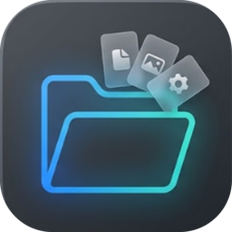
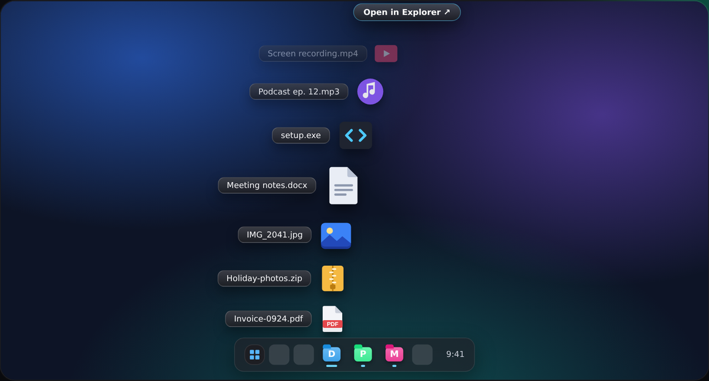

<p align="center"></p>

<h1 align="center">Foldy</h1>
<p align="center"><b>macOS-style fan stacks for your Windows taskbar.</b><br>
Pin any folder. Click it. Its contents spring out above the button along a smooth arc.</p>

<p align="center">
  <a href="https://github.com/vinchezko/Foldy/releases/latest/download/Foldy.exe"><b>⬇ Download Foldy.exe</b></a> ·
  <a href="https://vinchezko.github.io/Foldy/">Website &amp; live demo</a> ·
  <a href="https://github.com/vinchezko/Foldy/releases">Releases</a>
</p>

<p align="center"></p>

## Features

- **Pin as many folders as you like.** Each becomes its own real taskbar button with its own coloured icon.
- **Opens exactly above the button you clicked.** Foldy records the click itself and asks Windows (UI Automation) for that button's real rectangle, so it doesn't matter where the pointer goes afterwards. It reads the taskbar's real size too, so any display scale, taskbar size or auto-hide setup works and the fan never overlaps the taskbar.
- **Spring-physics animation**, staggered per item, timed per frame so it stays smooth at any refresh rate.
- **Fisheye hover** that pushes neighbours apart, so icons never collide.
- **Kinetic scrolling** for big folders: momentum, rubber-band at the ends, edge fades.
- **Fast.** Pinned buttons run a ~100 ms launcher; icons and labels are pre-loaded.
- **Compact settings window** (density, speed, glass opacity, magnification, arc curve, item count, sorting…) with a reset button on every slider.
- **Clean install and uninstall**, each with a live progress window. Uninstall is a hold-to-confirm ring button.
- **Private.** No network access, no telemetry.

## Install

1. Download **`Foldy.exe`** from the [latest release](https://github.com/vinchezko/Foldy/releases/latest) and run it.
2. An install window shows each step, then a folder picker opens. Pick a folder and Foldy pins it to the taskbar.
3. Click the new button. Add more folders any time from the tray icon.

Windows may show *"Windows protected your PC"* for a new, unsigned app: click **More info → Run anyway**.

> **Auto-pin note:** Windows has no public API for pinning to the taskbar, so Foldy uses an undocumented route and checks that it worked. If your Windows build blocks it, Foldy opens the shortcut in Explorer: right-click it → *Show more options* → *Pin to taskbar*.

Supported: Windows 10 / 11 (64-bit), taskbar at the bottom of the primary monitor (normal or auto-hide).

## Using it

| Action | Result |
|---|---|
| Click an item | Opens it with its default app |
| Click **Open in Explorer ↗** (top of the arc) | Opens the folder |
| Scroll wheel / touchpad | Scrolls long folders |
| Click outside, `Esc`, or the button again | Closes the fan |
| Tray icon → **Settings…** | Opens the settings window |
| Settings → **Uninstall** | Hold the ring button to remove Foldy completely |

## Build from source

Requires Windows and Python 3.11+.

```bat
git clone https://github.com/vinchezko/Foldy.git
cd Foldy
packaging\build.bat
```

That installs the dependencies, builds the tiny launcher, then builds the single-file **`dist\Foldy.exe`**
(`--onefile --noconsole`, icon and version info embedded, launcher included).

Run from source without building: `pip install PyQt6 pywin32`, then `python src\run_foldy.py`.

### Publishing a release

Build, then attach `dist\Foldy.exe` to a GitHub release. Keep the file name `Foldy.exe` so the website's download button works.

## Website

The site in [`docs/`](docs) is plain HTML/CSS/JS with no build step: parallax scrolling, a live port of the fan physics you can play with, a settings replica, install/uninstall demos and a download section.

1. Push the repo to GitHub.
2. **Settings → Pages → Build and deployment → Deploy from a branch → `main` / `/docs`.**
3. If your repository isn't `vinchezko/Foldy`, change `REPO` at the top of `docs/js/main.js` (and the `og:image`/links in `docs/index.html` if you like).

## Project layout

```
src/
  run_foldy.py          entry script (what PyInstaller bundles)
  foldy/                the app
    app.py              Foldy.exe entry: install hand-off, IPC
    hub.py              resident app: tray, IPC server, fan control, add/pin and uninstall flows
    fan.py              fan overlay: arc layout, springs, magnification, scrolling
    render.py           cached icons, glass labels, folder listings
    winutil.py          Windows helpers: taskbar geometry, UI Automation, click tracker
    shortcuts.py        shortcut icons, .lnk creation, taskbar pinning, folder picker
    settings.py, settings_window.py, installer.py, uninstaller.py, widgets.py, styles.py,
    ipc.py, constants.py, util.py
  launcher/launcher.py  tiny stdlib-only launcher that pinned buttons run (built to fsl.exe)
packaging/              PyInstaller specs, launcher packer, build.bat, version info
assets/                 app icon (.png / .ico)
docs/                   the website (GitHub Pages)
```

## How it works

* Each pinned shortcut carries its own AppUserModelID, so Windows treats every folder as a separate taskbar button.
* A click runs `fsl.exe`, which hands the click to the resident app over a named pipe. The app has been recording where the mouse button was released (a lightweight 250 Hz sampler that only runs fast while the pointer is near the bottom of the screen), then asks UI Automation for the exact button and the taskbar's real size.
* The fan is a small click-through overlay window: it never takes focus, and clicks pass through to everything except the fan.

## License

MIT, see [LICENSE](LICENSE). Made by [vinchezko](https://github.com/vinchezko).
